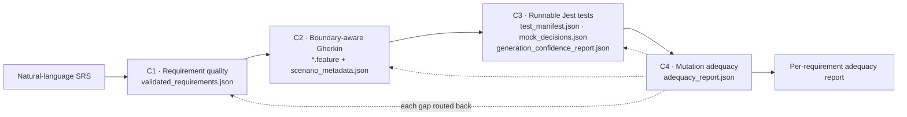

# Requirement-Driven BDD Test Generation and Mutation-Guided QA Evaluation

**IT4010 Research Project · 2026 · Group J26-SE-331**
Faculty of Computing, Sri Lanka Institute of Information Technology (SLIIT)

[](https://github.com/Tharsi-Rangan/J26-SE-331-BDD-QA-Framework/actions/workflows/ci.yml)


> A green build is not proof that the requirements were tested.

This repository holds a four-stage pipeline that takes requirements from an SRS, turns them into
boundary-aware BDD scenarios and runnable Jest tests, and then uses mutation testing to show **which
requirement each test really protects**. Every artefact carries the same requirement ID, so any result can
be traced back to the sentence it came from.

---

## Contents

1. [Team](#team)
2. [The problem](#the-problem)
3. [The solution](#the-solution)
4. [Status at PP1](#status-at-pp1)
5. [Repository structure](#repository-structure)
6. [Quick start](#quick-start)
7. [Running each component](#running-each-component)
8. [Shared contracts and IDs](#shared-contracts-and-ids)
9. [Testing and CI](#testing-and-ci)
10. [How we work](#how-we-work)
11. [Security and secrets](#security-and-secrets)
12. [Roadmap to PP2](#roadmap-to-pp2)
13. [Documentation](#documentation)

---

## Team

| Component | Member | Student ID | GitHub |
|---|---|---|---|
| **C1** Grounded Requirement Quality Analysis and Refinement | Jathusan J. | IT23297418 | [@Jathusan-Jesuthasan](https://github.com/Jathusan-Jesuthasan) |
| **C2** Boundary-Aware Gherkin Scenario Generation | Shanchika S. | IT23307162 | [@Shanchika](https://github.com/Shanchika) |
| **C3** Runnable Test Generation with Explainable Assertions and Mocking · orchestrator · contracts | Ranganathan T. (group leader) | IT23136656 | [@Tharsi-Rangan](https://github.com/Tharsi-Rangan) |
| **C4** Requirement-Aware Mutation-Based Test Adequacy Evaluation | Shajana G. | IT23164208 | [@Shajana9](https://github.com/Shajana9) |

**Supervisor:** Mr. Jeewaka Perera · **Co-supervisor:** Mr. Dinal Senadheera

---

## The problem

AI tools can generate tests that compile, run and pass, yet do not check what the requirement says.
We call these **false-runnable tests**. The problem grows because each step of the requirement-to-test
chain is studied on its own:

- requirement-quality tools stop at labelling defects;
- scenario generators check Gherkin syntax, not meaning or boundaries;
- test generators copy the code's behaviour (and its bugs) and do not explain their mocks;
- mutation testing reports a score per line, with no link back to the requirement at risk.

Nothing closes the loop at the level of **one requirement ID**.

---

## The solution



| Design rule | What it means |
|---|---|
| **One ID end to end** | `REQ-…` → `SCN-…` → `TST-…` → mutant; every file and every test name carries the ID |
| **Rules decide, models only read language** | Boundaries, mocks, strategies, confidence and gap types come from rules; models fill checked forms |
| **Never guess** | Missing facts become questions (C1) or stubs with a reason (C3) |
| **Small, open models** | Open-weight models of 8B parameters or fewer, behind one OpenAI-compatible interface |
| **Contracts between stages** | Stages talk only through versioned JSON files, validated in CI |

---

## Status at PP1

At PP1 each component runs on its own with pilot input, and the contracts are checked end to end on a golden
example. Running C1 → C4 in one command is the PP2 goal.

| | What works now | Main output |
|---|---|---|
| **C1** | SRS import (DOCX / PDF / Markdown), stable requirement IDs, rule + ML defect detection, evidence grounding, risk tiers, clarification questions, human-approved refinement, Textual terminal wizard | `c1/validated_requirements.json` |
| **C2** | Reads BDD-ready requirements, LLM baseline generator, numeric constraint extraction, equivalence partitions and boundary values, Gherkin validation, layered verification | `c2/features/*.feature`, `c2/scenario_metadata.json` |
| **C3** | Input reader, ts-morph dependency scan, rule-based mock decisions (R-01…R-08), model-derived mock behaviour, typed assertions with 12 checks, strategy rules, Jest writer, 4-layer verification, repair loop, confidence routing, buggy-vs-fixed pilot, HTML report with VS Code links. Evaluated on **10 real BugsJS bugs: 31 tests, 1 real bug detected (ESLint-22), 0 false alarms** | `c3/runnable_tests/`, `c3/test_stubs/`, `c3/*.json`, `c3/c3_report.html` |
| **C4** | StrykerJS 10 + Jest with per-test coverage, scores per module and per requirement, equivalent-mutant filter, survivor → test → scenario → requirement trace, trace-signal modes, gap classifier, ranked recommendations routed to C1 / C2 / C3, HTML view, ground-truth accuracy on Express-5 | `c4/adequacy_report.json`, `c4/adequacy_report.html` |
| **Orchestrator** | Creates a valid run folder and run ID, seeds it from a golden fixture, validates it | `runs/<RUN-ID>/orch/run.json` |

Details, results and limitations for each component are in its own README (see [Documentation](#documentation)).

---

## Repository structure

```
.
├─ packages/
│  ├─ c1-requirement-quality/   C1 (Python 3.12)   · owner Jathusan
│  ├─ c2-gherkin-generation/    C2 (TypeScript)    · owner Shanchika
│  ├─ c3-test-generation/       C3 (TypeScript)    · owner Tharsiga
│  ├─ c4-mutation-adequacy/     C4 (TypeScript)    · owner Shajana
│  ├─ orchestrator/             run folder, run ID, validation · owner Tharsiga
│  └─ contracts/                JSON Schemas, conventions, golden example, validator · all four
├─ fixtures/subjects/           subject-manifest.json for the pilot subjects
├─ evidence/                    screenshots and logs used as progress evidence
├─ docs/                        GETTING_STARTED.md, INTEGRATION_RULES.md
├─ .github/                     CI workflows, CODEOWNERS, pull-request template
└─ runs/                        run outputs (git-ignored)
```

---

## Quick start

### Prerequisites

| Tool | Version | Check |
|---|---|---|
| Git | any recent | `git --version` |
| Node.js | 22 LTS (22.12 or newer) | `node -v` |
| pnpm | 9.12.0 | `npm install -g pnpm@9.12.0` then `pnpm -v` |
| Python | 3.12 (C1 only) | `py -3.12 --version` |

### Install and check

```powershell
git clone https://github.com/Tharsi-Rangan/J26-SE-331-BDD-QA-Framework.git
cd J26-SE-331-BDD-QA-Framework
pnpm install
pnpm validate:contracts   # golden example passes every contract
pnpm typecheck            # all TypeScript packages
pnpm test                 # all TypeScript test suites
```

For C1 (Python):

```powershell
cd packages/c1-requirement-quality
py -3.12 -m venv .venv
.venv\Scripts\activate
pip install -e ".[dev]"
pytest
```

### Model settings

Components that call a model read an OpenAI-compatible endpoint from a `.env` file in their package.
Copy `.env.example` to `.env` and fill in your own values. **Never commit `.env`.**
The supervisor approved running Qwen2.5-Coder-7B-Instruct through the Hugging Face API (11 Oct 2026),
because the team's 8 GB laptops cannot run a 7B model locally. C3 caches every model answer, so runs can be
replayed offline (`LLM_CACHE=readonly`).

---

## Running each component

Every component follows the same command shape and accepts a golden fixture folder as `--in`
(see `docs/INTEGRATION_RULES.md`). Exit code 0 means success.

```powershell
# Prepare a run folder seeded from the golden example
pnpm orch run --in packages/contracts/fixtures/golden/example-registration --out runs/RUN-20261029-120000-demo

# C1: analyse an SRS (from packages/c1-requirement-quality, venv active)
c1 run --srs <file> --out runs/<RUN-ID> --run-id <RUN-ID> --registry <registry.json>

# C2: generate scenarios (boundary-aware mode)
$env:C2_GENERATION_MODE = 'boundary_aware'
pnpm c2 run --in runs/<RUN-ID> --out runs/<RUN-ID>

# C3: generate tests on a subject, then compare buggy vs fixed, then open the report
pnpm c3 run   --in runs/<RUN-ID> --out runs/<RUN-ID> --subject-root <path to subject>
pnpm c3 pilot --run runs/<RUN-ID> --buggy <buggy subject> --fixed <fixed subject> --label <name> --open

# C4: mutation adequacy
pnpm c4 run --in runs/<RUN-ID> --subject-root <path to subject> --out runs/<RUN-ID>

# Check any run folder against the contracts
node packages/contracts/scripts/validate.mjs runs/<RUN-ID>
```

**C3 BugsJS batch (10 bugs, one command, from the repo root):**

```powershell
powershell -ExecutionPolicy Bypass -File packages\c3-test-generation\scripts\run-bugsjs.ps1 -Open
```

It clones the BugsJS projects into `C:\c3-subjects`, runs C3 on each buggy version, runs the same tests on
the fixed version, and opens `runs\c3_batch_report.html`.

---

## Shared contracts and IDs

All hand-offs are versioned JSON Schemas in `packages/contracts/schemas/` (v1.0.0, frozen for PP1).

| Contract | Producer → consumer |
|---|---|
| `c1-validated-requirements` | C1 → C2 |
| `c2-scenario-metadata` (+ `.feature` files) | C2 → C3 |
| `c3-test-manifest`, `c3-mock-decisions`, `c3-confidence-report` | C3 → C4 |
| `c4-adequacy-report` | C4 → C1, C2, C3 |
| `subject-manifest`, `common` | shared |

| ID | Made by | Example |
|---|---|---|
| Requirement | C1 | `REQ-EX-001` |
| Scenario | C2 | `SCN-EX-001-02` |
| Test | C3 | `TST-EX-001-02-03` |
| Stub | C3 | `STB-EX-001-04` |
| Subject | C3 + C4 | `SUB-EX-1` |
| Mutant | StrykerJS | `12` |

`packages/contracts/fixtures/golden/example-registration/` is one complete, valid chain from requirement to
a real StrykerJS result.

---

## Testing and CI

GitHub Actions runs on every pull request and on every push to `main`:

- **node job:** `pnpm install --frozen-lockfile`, `pnpm typecheck`, `pnpm test`;
- **python job:** C1 `pytest` on Python 3.12 (CPU-only PyTorch, offline model settings);
- **contracts workflow:** validates the golden example against every schema.

TypeScript test suites on `main` at the PP1 checklist (29 Oct 2026):

| Package | Test files | Tests |
|---|---|---|
| C2 | 9 | 79 |
| C3 | 16 | 243 |
| C4 | 13 | 96 |
| Orchestrator | 2 | 14 |

C1 is tested with `pytest` (see the C1 README).

---

## How we work

- **Ownership:** each member edits only their own package; `CODEOWNERS` enforces it. Contract changes need a
  `contract-change` pull request approved by all four members.
- **Branches:** `<c1|c2|c3|c4|shared>/<feat|fix|docs>/<short-name>`, for example `c3/feat/input-reader`.
  Nobody pushes to `main` directly.
- **Commits:** end with the MS Planner task ID, for example `feat(c3): read feature files [C3-03]`.
- **Pull requests:** the template asks for the task ID and evidence; CI must be green before merging.
- **Progress:** MS Planner (updated weekly), RP diary entries and an AI-use log for every member.

---

## Security and secrets

- API keys live only in each package's `.env`, which is git-ignored.
- Model answer caches and run outputs (`model-cache/`, `runs/`) are git-ignored.
- C3 never sends a function body to a model: only the scenario steps, function names, parameters and JSDoc.
- Generated tests run in a temporary sandbox copy of the subject, not in the original folder.
- Redaction of personal data with Microsoft Presidio is designed (the C1 contract has a `redaction_applied`
  flag) and is planned for PP2; PP1 uses only public data (BugsJS projects and sample SRS documents).

---

## Roadmap to PP2

| Goal | What it adds |
|---|---|
| **End-to-end run** | One command runs C1 → C2 → C3 → C4 on one real SRS and its codebase |
| **Feedback loop** | C4 gaps are routed back to C1, C2 or C3 automatically, with human approval, and re-run |
| **Shared model interface + redaction** | One model gateway for every stage, with redaction on every call |
| **Stronger evaluation** | Unseen BugsJS bugs, baselines and ablations, confidence calibration (ECE), labelled ground truth |
| **Better scenarios** | Edge cases and risky boundary combinations aimed at where bugs hide |

---

## Documentation

| Document | Content |
|---|---|
| [docs/GETTING_STARTED.md](docs/GETTING_STARTED.md) | Set-up for every member, daily git routine |
| [docs/INTEGRATION_RULES.md](docs/INTEGRATION_RULES.md) | Ownership, run folder layout, CLI shape, IDs, contract changes |
| [packages/contracts/README.md](packages/contracts/README.md) | Contracts, key rules, golden example, validation |
| [packages/c1-requirement-quality/README.md](packages/c1-requirement-quality/README.md) | C1 set-up, commands, registry, refinement workflow |
| [packages/c2-gherkin-generation/README.md](packages/c2-gherkin-generation/README.md) | C2 run, generation modes |
| [packages/c3-test-generation/README.md](packages/c3-test-generation/README.md) | C3 pipeline, rules, pilot, BugsJS batch, HTML report |
| [packages/c4-mutation-adequacy/README.md](packages/c4-mutation-adequacy/README.md) | C4 run, trace-signal modes, status per task |
| [packages/orchestrator/README.md](packages/orchestrator/README.md) | Orchestrator run folder and validation |
